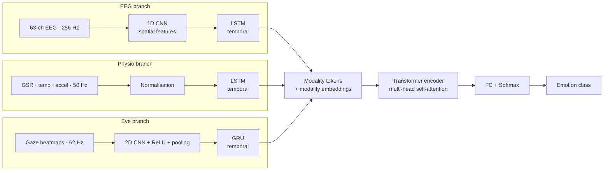

# Multi-Modal Emotion Recognition: Hybrid Deep Learning (CNN + LSTM + Transformer)

**An end-to-end deep learning model that recognises human emotions by fusing three biosignal streams: EEG (brain activity), physiological signals (GSR, temperature, accelerometer) and eye tracking. A Transformer handles cross-modal attention.**

Real emotions affect the brain, the body and the eyes at the same time. Single-modality systems (EEG-only or face-only) are noisy and limited. This model learns how the modalities relate, for example *"EEG shows stress → check whether physiological arousal is high → confirm anger."*

---

## Architecture



| Branch | Why this model |
|---|---|
| **CNN** | Spatial patterns: electrode topology and gaze-heatmap regions |
| **LSTM / GRU** | Temporal dynamics within each signal |
| **Transformer** | Cross-modal fusion. Each modality attends to the others |

## Dataset Modalities

| Modality | Description |
|---|---|
| **Core metadata** | Participant demographics, trial start/end times, and emotion labels (felt and perceived). Used to align modalities and provide ground truth |
| **EEG** | 63-channel recordings at 256 Hz that capture spatial and temporal brain activity |
| **GSR / physiological** | Skin conductance, body temperature and accelerometer data at 50 Hz, as measures of arousal and stress |
| **Eye tracking** | 16 channels of gaze coordinates and fixation points at 62 Hz, showing visual attention during stimuli |

## Method

1. **Input acquisition:** time-aligned EEG, physio and eye-tracking signals
2. **Preprocessing:** filtering, per-channel normalisation, and segmentation into frames of **50 timesteps**
3. **Feature extraction:** CNN+LSTM (EEG), LSTM (physio), CNN+GRU (eye)
4. **Fusion:** Transformer encoder layer with multi-head self-attention across the modality embeddings
5. **Classification:** fully connected layer with softmax
6. **Optimisation:** cross-entropy loss with the Adam optimiser. All branches are trained jointly

The pipeline was first developed and validated on **synthetic multimodal data** with the same shapes and sampling rates as the real recordings. That confirms the architecture is ready for real datasets.

## Project Structure

```
Multimodal-Emotion-Recognition-CNN-LSTM-Transformer/
├── src/
│   ├── model.py          # EEG / Physio / Eye branches + Transformer fusion
│   ├── data.py           # synthetic data generator + real-data Dataset template
│   └── train.py          # training and evaluation loop
└── requirements.txt
```

## Getting Started

```bash
pip install -r requirements.txt
python src/train.py --epochs 20            # trains on synthetic multimodal data
```

To use a real dataset, implement `load_real_dataset()` in `src/data.py` so it returns arrays shaped `eeg (N, 50, 63)`, `physio (N, 50, C_p)`, `eye (N, 50, 1, H, W)` and `labels (N,)`.

## Key Takeaways

- Multimodal learning (EEG + physio + eye) gives a more complete picture of emotion than any single signal
- EEG shows how the brain reacts, GSR shows emotional intensity and stress, and eye tracking shows where attention goes
- CNNs handle spatial patterns, RNNs handle time dependencies, and Transformers handle cross-modal attention

## Related Work

- Zheng et al. (2014): EEG + eye-tracking fusion improved accuracy from 71.7% to 73.6%
- Iacono et al. (2024): CNN-based EEG–eye fusion with spatially arranged EEG maps, 93.5% accuracy
- Li et al. (2023): TACOformer, cross-attention Transformer fusion
- Abdullah et al. (2021): "Multimodal Emotion Recognition using Deep Learning," *JASTT*, 2(01), 73–79
- Ma et al. (2024): PHemoNet, hypercomplex multimodal fusion

## Tech Stack

Python · PyTorch · NumPy · scikit-learn

## Team

Team 12 · Amrita Vishwa Vidyapeetham, Coimbatore

- Dodla Nithya Sai
- M. Vishnu Vardhan
- P. Sreekar Reddy
- S. Beena Reddy
