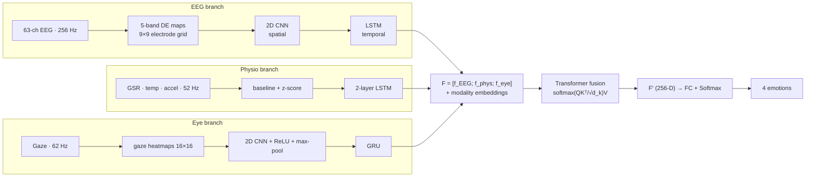

# Multi-Modal Emotion Recognition: Hybrid Deep Learning (CNN + LSTM + Transformer)

**An end-to-end deep learning model that recognises human emotions by fusing three biosignal streams recorded while people watch emotional face-to-face videos: EEG (brain activity), physiological signals (GSR, skin temperature, accelerometer) and eye tracking. A Transformer handles cross-modal attention.**

The model is trained and evaluated on the **real AFFEC dataset** (72 participants, 63-channel EEG, Shimmer GSR, Gazepoint eye tracking). A synthetic generator with identical tensor shapes is included for quick, download-free testing. Full results and discussion are in **[REPORT.md](REPORT.md)**.

---

## Architecture



| Component | Role |
|---|---|
| **CNN** | Spatial patterns: neighbouring electrodes × frequency bands, and gaze regions |
| **LSTM / GRU** | Temporal dynamics over the 50 timesteps of each trial |
| **Transformer** | Cross-modal fusion. Each modality attends to the others; missing modalities are masked out |
| **FC + Softmax** | `z = W_c F′ + b_c`, `p_i = e^{z_i} / Σ_j e^{z_j}` over *neutral, happy, sad, angry* |

## Dataset: AFFEC

**AFFEC (Advancing Face-to-Face Emotion Communication)**, brAIn lab, IT University of Copenhagen. Hosted on Zenodo ([v2, record 19408373](https://zenodo.org/records/19408373); GSR is only in [v0.1, record 14794876](https://zenodo.org/records/14794876)). BIDS format.

| Modality | Description | Used as |
|---|---|---|
| **Core metadata** | Participant demographics, trial events (onsets, stimulus emotion), felt and perceived valence/arousal ratings (1-9) | Alignment + labels |
| **EEG** | 63 channels (10-10), 256 Hz, g.tec g.HIamp | `(50, 5, 9, 9)` differential-entropy maps |
| **GSR / physiological** | Shimmer3: skin conductance, temperature, accelerometer, ~52 Hz | `(50, 6)` time series |
| **Eye tracking** | Gazepoint, 16 channels (fixation / left / right / best point of gaze + validity), 62 Hz | `(50, 1, 16, 16)` gaze heatmaps |

Each trial: fixation cross → scenario text → **emotional video (~3-4 s)** → felt and perceived ratings. We analyse a 5 s window starting at video onset, split into **50 timesteps of 0.1 s**, and baseline-correct against the fixation period before the video. Six participants flagged for exclusion (`ex = 1`) are dropped, leaving **66 participants and 5,306 trials**.

## Method

1. **Input acquisition**: EEG, physio and eye-tracking streams are time-aligned through the shared BIDS `onset` clock
2. **Preprocessing** (`scripts/preprocess_affec.py`):
   - EEG: band-pass into δ, θ, α, β, γ, then differential entropy `½ log(2πeσ²)` in 0.5 s sliding windows, mapped onto a 9×9 scalp grid
   - Physio: GSR conductance, GSR slope, temperature, 3-axis acceleration, frame-averaged
   - Eye: Gaussian-splatted gaze density per frame
   - Baseline correction (1 s pre-video), then per-subject z-scoring `x′ = (x − μ_f) / σ_f`
3. **Feature extraction**: CNN+LSTM (EEG), LSTM (physio), CNN+GRU (eye), each giving a 128-D vector `h_T`
4. **Fusion**: 2 Transformer layers with 4-head self-attention over the three modality tokens
5. **Classification**: fully connected layer giving a 256-D `F′`, then a linear layer and softmax
6. **Optimisation**: class-weighted cross-entropy with AdamW, cosine learning-rate schedule and early stopping on validation macro-F1. Modality dropout during training makes the model robust to missing sensors
7. **Evaluation**: **subject-independent** cross-validation (test participants are never seen in training), plus a subject-dependent random split for comparison

## Project Structure

```
├── scripts/
│   ├── download_affec.py        # fetch AFFEC from Zenodo (partial downloads, subject subsets)
│   ├── preprocess_affec.py      # raw BIDS → data/processed/affec_T50.npz
│   ├── run_ablation.py          # every modality subset (EEG / physio / eye / pairs / all)
│   ├── run_all_experiments.sh   # reproduces every number in REPORT.md
│   └── make_figures.py          # dataset + feature figures for the report
├── src/
│   ├── features.py              # EEG DE topomaps, physio frames, gaze heatmaps
│   ├── data.py                  # AFFEC loader, label schemes, synthetic generator, Dataset
│   ├── model.py                 # EEG / Physio / Eye branches + Transformer fusion
│   ├── train.py                 # training, k-fold CV, metrics, plots
│   └── predict.py               # inference: probabilities + cross-modal attention
├── tests/test_pipeline.py       # pytest: shapes, masking, feature extraction
├── docs/figures/                # figures used in the report
├── REPORT.md                    # full project report with results
└── requirements.txt
```

## Getting Started

```bash
pip install -r requirements.txt
```

**Quick test on synthetic data (no download):**

```bash
python src/train.py --data synthetic --epochs 20 --split random
```

**Full pipeline on the real AFFEC data:**

```bash
python scripts/download_affec.py --out data/raw/affec        # ~12 GB (EEG + gaze + GSR + core)
```

```bash
python scripts/preprocess_affec.py --raw data/raw/affec --out data/processed/affec_T50.npz
```

```bash
python src/train.py --data data/processed/affec_T50.npz --labels stimulus4 --split subject --folds 5
```

```bash
python src/predict.py --checkpoint outputs/main_stimulus4_subject/model_fold0.pt --data data/processed/affec_T50.npz
```

Use `--subjects 10` on the downloader for a smaller trial run. `bash scripts/run_all_experiments.sh` reproduces every result in the report.

### Label schemes (`--labels`)

| Scheme | Classes | Source |
|---|---|---|
| `stimulus4` (default) | neutral, happy, sad, angry | emotion portrayed in the video (`trial_type`) |
| `stimulus6` | + fear, disgust | all six AFFEC categories |
| `felt_va4` | valence × arousal quadrants | participant's **felt** self-report (split at 5) |
| `perceived_va4` | valence × arousal quadrants | participant's **perceived** self-report |

## Results

See [REPORT.md](REPORT.md) for the full tables, confusion matrices and modality ablation. Recognising emotions in participants the model has never seen (the subject-independent split) is much harder than the subject-dependent split. The report discusses this gap honestly.

## Key Takeaways

- Multimodal learning (EEG + physio + eye) gives a more complete picture of emotion than any single signal
- EEG shows how the brain reacts, GSR shows emotional intensity and stress, and eye tracking shows where attention goes
- CNNs handle spatial patterns, RNNs handle time dependencies, and Transformers handle cross-modal attention

## Related Work

- Zheng et al. (2014): EEG + eye-tracking fusion improved accuracy from 71.7% to 73.6%
- Iacono et al. (2024): CNN-based EEG–eye fusion with spatially arranged EEG maps, 93.5% accuracy
- Li et al. (2023): TACOformer, cross-attention Transformer fusion
- Abdullah et al. (2021): "Multimodal Emotion Recognition using Deep Learning," *JASTT*, 2(01), 73–79
- Ma et al. (2024): PHemoNet, hypercomplex multimodal fusion
- AFFEC dataset: brAIn lab, IT University of Copenhagen, [arXiv:2504.18969](https://arxiv.org/abs/2504.18969)

## Tech Stack

Python · PyTorch · NumPy · SciPy · MNE · pandas · scikit-learn · Matplotlib

## Team

Team 12 · Amrita Vishwa Vidyapeetham, Coimbatore

- Dodla Nithya Sai
- M. Vishnu Vardhan
- P. Sreekar Reddy
- S. Beena Reddy
