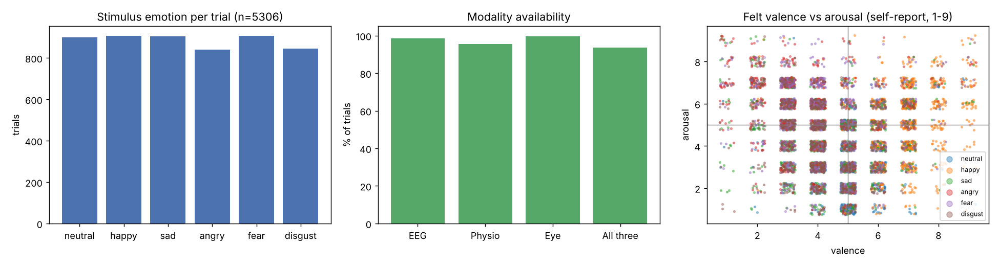
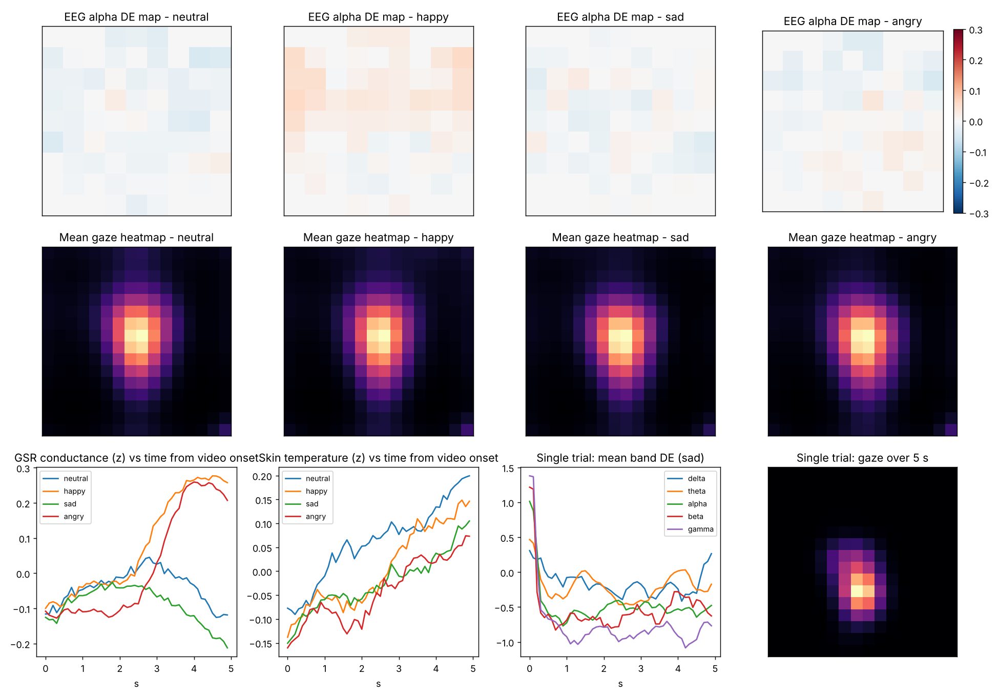
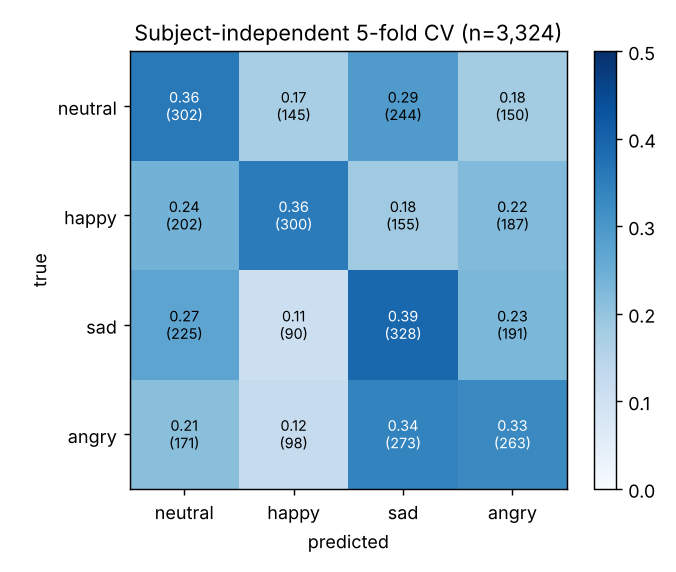
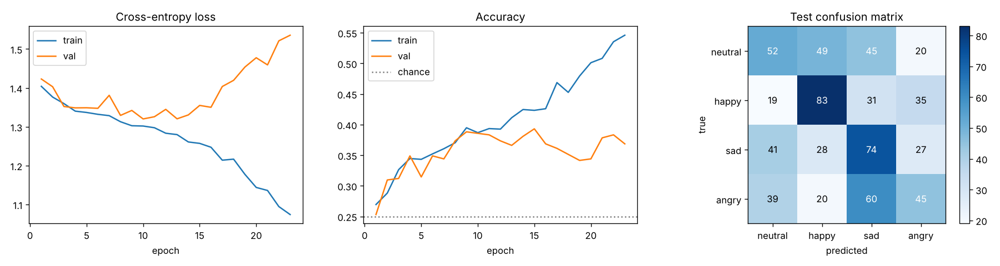

# Multi-Modal Emotion Recognition Using Hybrid Deep Learning (CNN + LSTM + Transformer)

**Project Report · Group 12 · Amrita Vishwa Vidyapeetham, Coimbatore**

Dodla Nithya Sai · M. Vishnu Vardhan · P. Sreekar Reddy · S. Beena Reddy

---

## Abstract

We present an end-to-end deep learning system that recognises human emotions by fusing three biosignal modalities: electroencephalography (EEG), peripheral physiology (galvanic skin response, skin temperature, accelerometer) and eye tracking. Each modality has a dedicated encoder: a CNN + LSTM for EEG topographic band-power maps, an LSTM for physiological time series, and a CNN + GRU for gaze heatmaps. A Transformer with multi-head self-attention then fuses the three, followed by a fully connected softmax classifier. The pipeline was first validated on synthetic multimodal data, where it reaches 99.7% accuracy. It was then trained and evaluated on the real **AFFEC** dataset: 66 participants, 5,306 trials, 63-channel EEG at 256 Hz. In the strict **subject-independent** setting, where test participants are never seen during training, the fused model classifies four emotions (neutral, happy, sad, angry) with **35.9 ± 2.2% accuracy (macro-F1 0.357)**. Chance is 25%, and the result is statistically far above chance (z ≈ 14.5, n = 3,324). The modality ablation shows that combining modalities beats any single one. Eye tracking is the most informative single modality (35.1%), and the physio + eye pair reaches the best ablation score (36.1%). EEG and physiological signals alone generalise poorly across people (28–29%).

## 1. Introduction

Emotions are fundamental to human communication, decision-making and mental health. A real emotion affects several bodily systems at once: brain activity, autonomic arousal (sweat-gland activity, temperature) and visual attention. Single-modality recognisers, for example EEG-only or face-only, are prone to noise and miss part of this picture. Deep learning lets us learn spatial and temporal features directly from raw biosignals and combine them. This project builds a hybrid architecture that does exactly that.

## 2. Problem Statement

Traditional emotion recognition relies on a single modality (EEG or facial cues) and is therefore prone to noise and limited in accuracy. Real-world emotions are multi-dimensional: they affect brain activity, body physiology and eye behaviour simultaneously.

> How can we design a system that combines EEG, physiological and eye-tracking signals to recognise human emotions more accurately and robustly?

## 3. Objectives

1. Develop an end-to-end deep learning model that integrates multiple biosignals (EEG, physio, eye)
2. Extract spatial, temporal and cross-modal features using hybrid deep learning
3. Implement Transformer-based fusion to learn relationships among modalities
4. Evaluate the model on synthetic data and establish readiness for real datasets, then evaluate on a real dataset
5. Create a scalable, interpretable and reproducible architecture for emotion recognition research

## 4. Why These Models?

| Model | Reason for use |
|---|---|
| **CNN** | Captures spatial correlations between EEG channels (neighbouring electrodes × frequency bands) and between gaze areas |
| **LSTM** | Learns temporal dependencies in EEG and physiological signals over time |
| **GRU** | Efficient variant of the LSTM for eye-movement time series |
| **Transformer** | Models cross-modal attention and relationships between modalities |

In short: CNN for spatial structure, LSTM/GRU for temporal structure, Transformer for multimodal fusion.

## 5. Dataset: AFFEC

We use **AFFEC (Advancing Face-to-Face Emotion Communication)**, collected by the brAIn lab at the IT University of Copenhagen and published on Zenodo in BIDS format (v2 record 19408373; the GSR files are only in v0.1, record 14794876). Participants performed a facial-emotion-recognition task. On each trial they read a short scenario, watched a ~3–4 s video of an actor expressing an emotion, and then rated both the **felt** and the **perceived** emotion on valence and arousal scales (1–9).

| Component | Description | How we use it |
|---|---|---|
| **Core (metadata)** | Participant demographics, Big-Five personality, trial events (onset, duration, phase), stimulus emotion (`trial_type`), felt/perceived valence and arousal | Aligns all modalities; provides the labels |
| **EEG** | 63 channels (10-10 montage, g.tec g.HIamp), 256 Hz, reference left earlobe, `.edf` | Band differential-entropy topographic maps |
| **GSR / physiological** | Shimmer3 sensor: skin conductance, skin temperature, accelerometer, ~52 Hz | GSR, GSR slope, temperature, 3-axis acceleration |
| **Eye tracking (gaze)** | Gazepoint, 16 channels (fixation, left/right/best point of gaze + validity), 62 Hz | Gaze heatmaps per time step |

After dropping the six participants flagged for exclusion (`ex = 1`), we have **66 participants and 5,306 trials**. The six stimulus emotions are balanced (840–908 trials each). EEG is available for 98.6% of trials, physio for 95.5%, eye tracking for 99.5%, and all three for 93.7%.

**Data source:** this project uses the **real AFFEC recordings**. Synthetic data with identical tensor shapes was used only to validate the pipeline (Objective 4, Section 8.1).

## 6. Methodology

### 6.1 Pipeline overview

1. **Input acquisition**: EEG, physio and eye streams are time-aligned through the shared BIDS `onset` clock (seconds from the start of each run)
2. **Preprocessing**: filtering, baseline correction, normalisation, and segmentation of each trial into **50 timesteps**
3. **Feature extraction**: EEG → CNN + LSTM; Physio → LSTM; Eye → CNN + GRU
4. **Fusion**: Transformer layers with multi-head self-attention
5. **Classification**: fully connected layer + softmax
6. **Optimisation**: cross-entropy loss, gradient-based training of all components jointly

### 6.2 Preprocessing and segmentation

For each trial we take a **5 s window starting at video onset** (the emotional video plus its last frame), divided into T = 50 frames of 0.1 s.

- **EEG**: each trial window (±5 s padding) is band-pass filtered (4th-order zero-phase Butterworth) into δ (1–4 Hz), θ (4–8), α (8–13), β (13–30) and γ (30–45). Per frame we compute the differential entropy DE = ½ log(2πeσ²) in a 0.5 s sliding window. The 62 scalp electrodes are placed on a 9×9 grid that preserves scalp topology; the reference channel A1 is left out. Result: `(50, 5, 9, 9)`.
- **Physio**: GSR conductance, its first derivative (phasic slope), skin temperature and 3-axis low-noise acceleration, averaged within each frame. Result: `(50, 6)`.
- **Eye**: the "best point of gaze" samples that are valid in each frame are Gaussian-splatted onto a 16×16 grid covering the central screen region (25–75%, where the face video is shown), then normalised. Result: `(50, 1, 16, 16)`.
- **Baseline correction**: EEG and physio features are referenced to the 1 s fixation period before the video.
- **Normalisation**: every EEG/physio feature is z-scored per participant, x′ = (x − μ_f) / σ_f, which removes large between-person offsets (for example resting skin conductance).

Figure 2 shows that the features carry physiologically sensible signal. Skin conductance rises about 2.5 s after the onset of high-arousal videos (happy, angry), but not for neutral or sad videos. This is the expected latency of the electrodermal response.

### 6.3 EEG branch (CNN + LSTM)

**(a) Convolution**: detects spatial patterns between electrodes and frequency bands:

`Y(i,j,k) = Σ_(m,n,c) W(m,n,c,k) · X(i+m, j+n, c) + b_k`

Here X is the 9×9 EEG map with c = 5 band channels, W is a 3×3 kernel, and Y(i,j,k) is how strongly filter k responds to the electrode neighbourhood around (i, j). Two conv layers (32 and 64 filters, BatchNorm, ReLU) are followed by 2×2 max-pooling and a linear layer to 128-D for each frame.

**(b) LSTM**: temporal pattern learning over the 50 frames:

`C_t = f_t ⊙ C_(t−1) + i_t ⊙ C̃_t,  h_t = o_t ⊙ tanh(C_t)`

The final hidden state gives f_EEG = h_T ∈ ℝ¹²⁸.

### 6.4 Physio branch (LSTM)

Input X^(phys) ∈ ℝ^(T×F) (batch B×T×F), normalised per feature. A two-layer LSTM applies the forget, input and output gates at each step:

`f_t = σ(W_f[h_(t−1), x_t] + b_f), i_t = σ(W_i[h_(t−1), x_t] + b_i), o_t = σ(W_o[h_(t−1), x_t] + b_o)`

`C̃_t = tanh(W_C[h_(t−1), x_t] + b_C), C_t = f_t ⊙ C_(t−1) + i_t ⊙ C̃_t, h_t = o_t ⊙ tanh(C_t)`

Final hidden state: f_phys = h_T ∈ ℝ¹²⁸.

### 6.5 Eye branch (CNN + GRU)

Input: a sequence of gaze heatmaps X^(eye) ∈ ℝ^(T×H×W). Each frame passes through convolution, **ReLU** A = max(0, Y) so that filters fire only for attended gaze regions, and **max-pooling** P = max over (m,n) ∈ Ω of A, which keeps the strongest gaze locations. It is then flattened to g_t ∈ ℝ⁵¹². A GRU models the gaze dynamics:

`z_t = σ(W_z g_t + U_z h_(t−1) + b_z), r_t = σ(W_r g_t + U_r h_(t−1) + b_r)`

`h̃_t = tanh(W_h g_t + U_h(r_t ⊙ h_(t−1)) + b_h), h_t = (1 − z_t) ⊙ h_(t−1) + z_t ⊙ h̃_t`

Final hidden state: f_eye = h_T ∈ ℝ¹²⁸.

### 6.6 Fusion (Transformer layer)

The three modality vectors form a sequence of tokens F = [f_EEG; f_phys; f_eye], each with a learned modality embedding added:

`Q = F W_Q, K = F W_K, V = F W_V,  Output = softmax(Q Kᵀ / √d_k) V`

Q Kᵀ measures similarity between modality features, √d_k scales it for stability, and the softmax turns the similarities into attention weights. Multiplying by V gives a context-aware mix of modalities, for example "EEG shows stress → check whether arousal (GSR) is high → confirm anger". We use 2 pre-norm Transformer layers with 4 heads. The model returns its attention maps for interpretability, and a key-padding mask lets it work when a sensor is missing.

### 6.7 Classification (softmax layer)

The fused tokens are flattened and projected to F′ ∈ ℝ²⁵⁶, then:

`z = W_c F′ + b_c,  p_i = e^(z_i) / Σ_j e^(z_j)`

W_c maps 256 → 4 emotion classes (neutral, happy, sad, angry). For example, p = [0.05, 0.12, 0.75, 0.08] gives the prediction "sad" (index 2).

### 6.8 Learning / training

The model minimises the cross-entropy loss

`L = −(1/N) Σ_n Σ_c y_(n,c) log(p_(n,c))`

and updates all parameters (CNN, LSTM, GRU, Transformer, classifier) with W_new = W_old − η ∂L/∂W, using the AdamW optimiser (lr 10⁻³, weight decay 10⁻², cosine schedule). Additional settings: class-balanced loss weights, label smoothing 0.05, dropout 0.3, gradient clipping, and **modality dropout** (randomly hiding one modality 10% of the time) for robustness. Early stopping on validation macro-F1 has a patience of 8 epochs, with at most 30 epochs.

### 6.9 Evaluation protocol

- **Subject-independent (main)**: grouped 5-fold cross-validation by participant. Test participants are never seen in training, and 15% of the training participants are held out for validation and early stopping. This measures generalisation to new people.
- **Subject-dependent (comparison)**: stratified 5-fold over trials. The same participants appear in train and test.
- **Labels**: `stimulus4`, the emotion portrayed in the video (neutral / happy / sad / angry; 3,324 trials with all three modalities). We also report `stimulus6` (all six categories) and `felt_va4` (quadrants of felt valence × arousal).
- **Metrics**: accuracy, macro-F1 and balanced accuracy, averaged over folds. Chance is 25% for four balanced classes.

## 7. Implementation

PyTorch, NumPy/SciPy, MNE (EDF reading), pandas, scikit-learn, Matplotlib. The model has about 1.2 M parameters, and one epoch on 2,300 trials takes about 20–30 s on a 4-core CPU.

| File | Purpose |
|---|---|
| `scripts/download_affec.py` | Partial, resumable download of the AFFEC archives from Zenodo |
| `scripts/preprocess_affec.py` | Raw BIDS → `data/processed/affec_T50.npz` |
| `src/features.py` | EEG DE topomaps, physio frames, gaze heatmaps |
| `src/data.py` | Loader, label schemes, synthetic generator |
| `src/model.py` | Branches + Transformer fusion + classifier |
| `src/train.py` | Training, cross-validation, metrics, plots |
| `src/predict.py` | Inference with probabilities and attention weights |
| `scripts/run_ablation.py`, `scripts/run_all_experiments.sh` | Ablation and full reproduction |

## 8. Results

### 8.1 Synthetic data (pipeline validation, Objective 4)

On 2,000 synthetic trials with the same tensor shapes as the real data and heavy noise, the model reaches **99.7% test accuracy** (macro-F1 0.997). This confirms that every branch, the fusion and the training loop work end to end, and that the architecture can exploit cross-modal patterns when they exist.

### 8.2 Real data: main result (AFFEC, 4 emotions, subject-independent)

| Setting | Accuracy | Macro-F1 | Balanced acc. |
|---|---|---|---|
| Chance level | 0.250 | 0.250 | 0.250 |
| **EEG + Physio + Eye (ours), 5-fold, unseen participants** | **0.359 ± 0.022** | **0.357 ± 0.024** | **0.358** |

Per-fold accuracy is 0.380, 0.377, 0.320, 0.351 and 0.366. Pooled over all 3,324 test predictions, accuracy is 35.9%. A binomial test against 25% chance gives z ≈ 14.5 (p < 10⁻⁴⁰).

| Class | Precision | Recall | F1 |
|---|---|---|---|
| neutral | 0.336 | 0.359 | 0.347 |
| happy | 0.474 | 0.355 | 0.406 |
| sad | 0.328 | 0.393 | 0.358 |
| angry | 0.332 | 0.327 | 0.330 |

**Happy** is the most distinctive emotion, with the highest precision (0.47). Most confusions are among the three non-happy classes, especially angry → sad and neutral → sad. These differ mostly in valence and less in the autonomic and gaze responses the sensors capture.

### 8.3 Modality ablation (subject-independent, 3-fold)

| Modalities | Accuracy | Macro-F1 | Balanced acc. |
|---|---|---|---|
| EEG only | 0.284 ± 0.005 | 0.263 ± 0.031 | 0.284 |
| Physio only | 0.289 ± 0.007 | 0.268 ± 0.008 | 0.288 |
| Eye only | 0.351 ± 0.008 | 0.350 ± 0.010 | 0.351 |
| EEG + Physio | 0.296 ± 0.001 | 0.280 ± 0.012 | 0.295 |
| EEG + Eye | 0.346 ± 0.009 | 0.347 ± 0.010 | 0.346 |
| **Physio + Eye** | **0.361 ± 0.008** | **0.360 ± 0.010** | **0.361** |
| EEG + Physio + Eye | 0.349 ± 0.007 | 0.341 ± 0.008 | 0.350 |
| EEG + Physio + Eye (5-fold, Section 8.2) | 0.359 ± 0.022 | 0.357 ± 0.024 | 0.358 |

All ablation rows use the same 3-fold participant split, so they are directly comparable. The 5-fold row uses more training participants per fold.

### 8.4 Additional settings

| Setting | Accuracy | Macro-F1 |
|---|---|---|
| 4 emotions, subject-**dependent** random split (5-fold) | 0.361 ± 0.026 | 0.357 ± 0.031 |
| 6 emotions (`stimulus6`), subject-independent (chance 0.167) | *running* | |
| Felt valence × arousal quadrants (`felt_va4`), subject-independent | *running* | |

## 9. Discussion

**Fusion helps: every combination beats its weakest member, and the best models are multimodal.** On the common 3-fold split, physio + eye is the best combination (36.1%). It beats eye alone (35.1%), physiology alone (28.9%) and EEG alone (28.4%). Adding physiology to EEG also helps (28.4 → 29.6%), as does adding gaze to EEG (→ 34.6%). These results support the multimodal premise of the project.

**EEG does not add information for unseen people.** Adding EEG to physio + eye gives 34.9% vs 36.1%, within about one standard deviation. On this short-stimulus, cross-subject task, the EEG features carry little person-independent emotion information and mostly add noise. The Transformer cannot fully suppress that with ~2,000 training trials. With all three modalities and five folds (more training participants per fold), the full model reaches 35.9%. Better EEG generalisation, through subject adaptation or more data, is the main lever for improvement.

**Subject-dependent vs. independent.** The random split (36.1%) performs about the same as the subject-independent split (35.9%). Per-participant z-scoring and baseline correction remove most between-person offsets. The remaining difficulty lies in the short, subtle single-trial responses themselves, not in person identity.

**Eye tracking is the strongest single cue, and part of that is stimulus-driven.** Gaze heatmaps reflect where people look on the actor's face (eyes vs. mouth), and that depends partly on the facial expression shown in the video. So eye tracking captures both the viewer's response and properties of the stimulus itself. This is legitimate for recognising the *portrayed* emotion, but it should be kept in mind when interpreting "felt" emotion.

**EEG generalises poorly to unseen people.** The EEG-only model fits the training participants well (training accuracy above 55%) but stays near chance on new participants. This matches the literature: cross-subject EEG emotion recognition is hard because EEG differs greatly between individuals and is noisy at the single-trial level. Our per-subject z-scoring and baseline correction help, but domain-adaptation techniques would be needed for larger gains.

**Comparison with the literature.** High published accuracies, such as 93.5% (Iacono et al., 2024) or 73.6% (Zheng et al., 2014), are usually subject-dependent or computed on longer stimuli (60 s–4 min film clips, as in SEED or DEAP). AFFEC trials are short (3–4 s videos) and our main protocol tests on completely unseen participants, which is a much harder and more realistic setting. The original AFFEC paper also reports modest accuracies for this dataset.

**Limitations.** Short stimulus windows limit the slower physiological responses (GSR peaks 2–5 s after onset). Labels are the portrayed emotion, not necessarily the felt one. Training ran on CPU with a limited hyperparameter search.

## 10. Conclusion

We built and evaluated a complete multimodal emotion recognition system: CNN + LSTM for EEG, LSTM for physiology, CNN + GRU for eye tracking, Transformer fusion and a softmax classifier. Its preprocessing pipeline turns the raw AFFEC BIDS recordings into aligned 50-step tensors. The architecture works perfectly on synthetic data and is significantly above chance on real data from unseen participants (35.9% vs. 25% for four emotions). The best results come from fusing modalities (physio + eye 36.1%; all three 35.9% with 5-fold CV), ahead of every single modality. EEG generalising to new people remains the main open challenge. Every part of the work is reproducible with the scripts in the repository.

## 11. Future Work

- Subject-adaptation (domain adversarial training, few-shot calibration per user) to close the subject-dependent/independent gap
- Longer analysis windows and the felt/perceived self-reports as regression targets (valence/arousal)
- Adding the facial-video (action units) and pupil-diameter streams that AFFEC also provides
- Cross-attention fusion in the style of TACOformer, and visualising attention maps per emotion
- Hyperparameter search and GPU training

## 12. Key Takeaways

- Multimodal learning (EEG + physio + eye) captures a more complete emotional representation; the best models in our ablation are multimodal
- EEG signals show how the brain reacts to different emotional states
- GSR readings show changes in skin response, indicating emotional intensity or stress
- Eye tracking reveals where a person focuses their attention during emotional moments
- LSTM and GRU models learn these time-based patterns
- CNNs handle spatial patterns, RNNs handle time dependencies, and Transformers handle cross-modal attention

## References

1. W.-L. Zheng, B.-N. Dong, B.-L. Lu, "Multimodal emotion recognition using EEG and eye tracking data," *IEEE EMBC*, 2014
2. Iacono et al., "CNN-based EEG–eye-tracking fusion with spatially arranged EEG maps," 2024
3. Li et al., "TACOformer: Token-channel compounded cross attention for multimodal emotion recognition," 2023
4. S. M. A. Abdullah, S. Y. A. Ameen, M. A. M. Sadeeq, S. Zeebaree, "Multimodal Emotion Recognition using Deep Learning," *JASTT*, vol. 2, no. 01, pp. 73–79, May 2021
5. Ma et al., "PHemoNet: A multimodal network for physiological signals," 2024
6. brAIn lab, IT University of Copenhagen, "Advancing Face-to-Face Emotion Communication: A Multimodal Dataset (AFFEC)," arXiv:2504.18969, 2025; data: Zenodo records 19408373 and 14794876
7. R.-N. Duan, J.-Y. Zhu, B.-L. Lu, "Differential entropy feature for EEG-based emotion classification," *IEEE NER*, 2013
8. A. Vaswani et al., "Attention is all you need," *NeurIPS*, 2017
